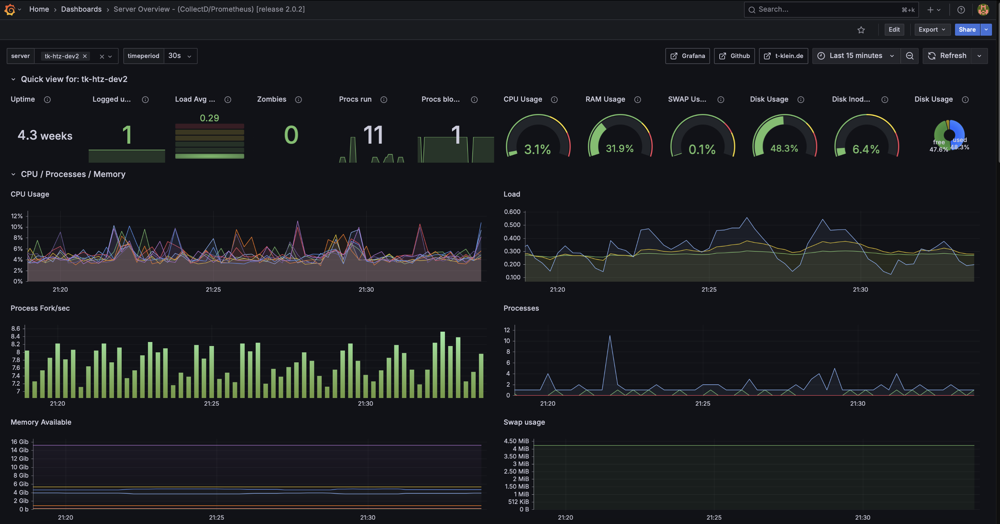
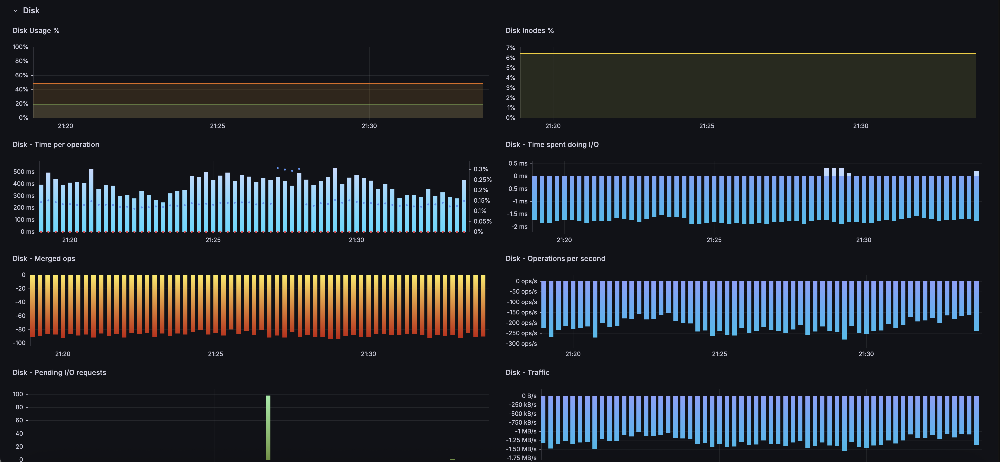
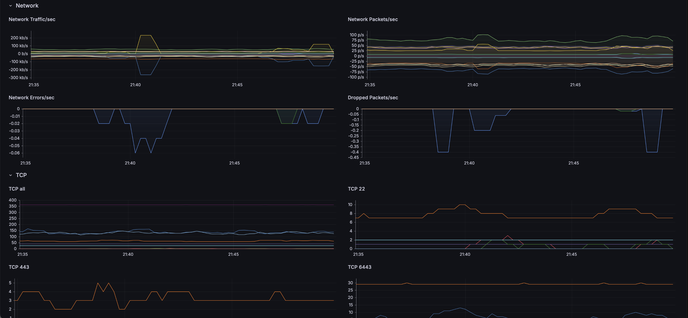
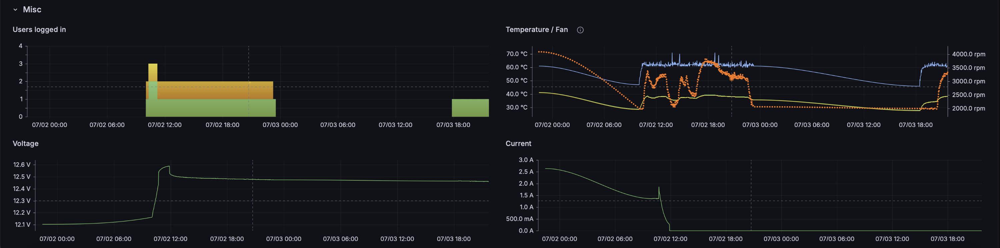

# Grafana Dashbords

The dashboard shows **Collectd** metrics exported by the *writePrometheus* plugin to Prometheus/Mimir backend. Although CollectD with Graphite backend is the preferred combination, this dashboard facilitates the migration to the Prometheus backend while retaining existing CollectD sensors.




## Collectd --(pull)--> Prometheus --(pull)--> Grafana

Published @GrafanaLabs: [Grafana Dashboard](https://grafana.com/grafana/dashboards/23643)  
Consultancy: [t-klein.de](https://www.t-klein.de)

### Features:
✅  multiple nodes select  
✅  datasource configurable on import  
✅  Quick view  
✅  Metric Panels  
✅   - Uptime  
✅   - Users  
✅   - CPU  
✅   - RAM  
✅   - Memory,Swap  
✅   - Processes/Load  
✅   - Disk Usage,Inodes,Ops  
✅   - Network Traffic,Errors,TCP  
✅   - Sensors Fan,Voltage,Current  


### Collectd Config
configure write_prometheus plugin and scrape using Prometheus, Mimir or OTEL Connector

```
LoadPlugin write_prometheus
<Plugin write_prometheus>
  Port "9103"
  Host "0.0.0.0"
</Plugin>
```
📌 See test config files in [collectd.d](docker/collectd/collectd.d) for more details on plugins.  

📌 Note that "Plugin cpu" uses "ValuesPercentage true" which differs from default config and is strictly needed to show correct panel.  


### Compatibility
The [docker-compose.yml](docker/docker-compose.yml) file starts a complete Collectd/Prometheus/Grafana toolchain to test the dashboard.  
- tested with Grafana 13.0
  - should work also with 12.x and below (change "__requires" in json before import!)
  - get older versions of the json file from the repository history for full compatibility with older Grafana versions
- tested with collectd 5.12.0
- tested with Prometheus v3.13.4


## Test
1. Run Docker compose in [docker](docker) to start an environment with Collectd, Prometheus and Grafana.  
2. Open Grafana UI at [localhost](http://127.0.0.1:8086) default login (admin/admin)
3. Configure Prometheus datasource: http://prometheus:9090
4. Import dashboard: [grafana_collectd_prometheus.json](grafana_collectd_prometheus.json)
5. Select 'host-x' as server in the dashboard's upper left select box

## Known bugs

- in Test Docker Collectd container:
  - [info] sensors plugin: lm_sensors reports no features. Data will not be collected.
    - no sensor data like temperature etc. can be tested in the current configuration
    - adding `privileged: true` and `volumes: - /sys:/sys:ro` could enable sensor data, but not set here since potentially insecure 
- in Test Docker Collectd container:
  - [error] write_prometheus plugin: MHD_OPTION_EXTERNAL_LOGGER is not the first option specified for the daemon. Some messages may be printed by the standard MHD logger.
  - don't care, will be fixed with next prometheus version


## Acknowledgements
Grafana Trademark see [grafana.com](https://grafana.com)


## License
licensed under the MIT license — see the [LICENSE](LICENSE) file for details.   
Copyright (c) 2025-2026 Thomas Hubertus Klein
